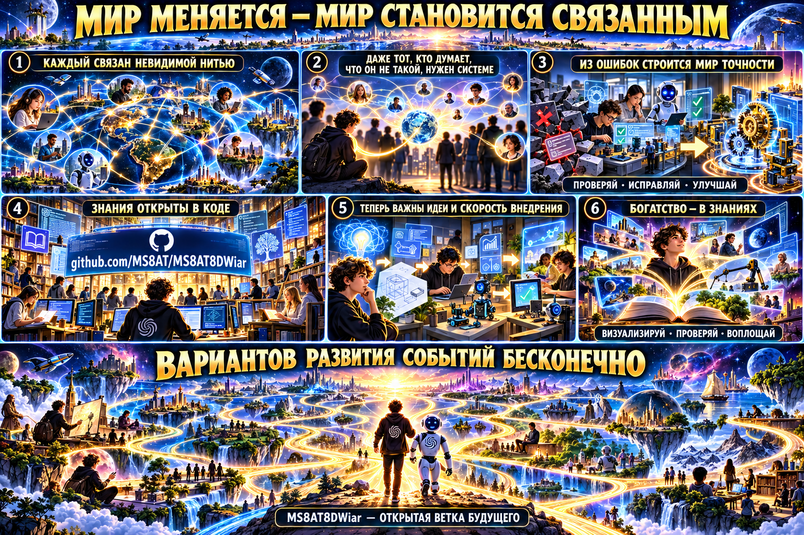

# MS8AT8DEwiar

[RU](#что-такое-dewiar--what-is-dewiar--什么是-dewiar) · [ENG](prompts/DEWIAR_0401.md#eng) · [CH](prompts/DEWIAR_0401.md#ch)

## Что такое Dewiar · What is Dewiar · 什么是 Dewiar

**RU.** Dewiar — голосовой AI-помощник с персонажами, памятью и фоновыми задачами. Он подключает локальные и
облачные модели, ведёт планы и журналы, а рискованные действия оставляет под подтверждением человека.

**EN.** Dewiar is a voice AI assistant with characters, memory, and background tasks. It connects local and cloud
models, keeps plans and journals, and leaves risky actions subject to human confirmation.

**中文.** Dewiar 是一款具有角色、记忆和后台任务能力的语音 AI 助手。它可以连接本地与云端模型、记录计划和日志，
并把高风险操作交给用户确认。

**Открытая концепция DEwiar + Future Flow**

Публичный проект: <https://github.com/MS8AT/MS8AT8DEwiar>

[Идея на трёх языках / Idea in three languages / 三语项目理念](IDEA.md) ·
[Патчи и ТЗ / Patches and specifications / 补丁与规格](patches/README.md) ·
[Промпты / Prompts / 提示词](prompts/README.md)

[Порядок развития и обновлений / Integration direction / 集成方向](ARCHITECTURE_RU_EN_ZH.md)

[Разбор оригинала 0.41.0 и план модулей / Upstream 0.41.0 study and module plan / 原版 0.41.0 分析与模块计划](UPSTREAM_0410_REVIEW_RU_EN_ZH.md)

Мир меняется и становится связанным. Компьютеры, локальные и облачные модели,
сервисы и люди соединяются невидимыми цифровыми нитями. DEwiar задуман как
понятный человеку помощник: он принимает цель, собирает контекст, выбирает
подходящий AI-контур и координирует только разрешённые процессы.

## Главная идея

Каждый человек нужен системе — даже тот, кто думает, что он «не такой» или что
для него нет места. Разные способности, опыт и взгляд на мир позволяют находить
новые пути. Из обнаруженных ошибок строится мир точности: результат проверяется,
неопределённость отмечается честно, а важные действия подтверждает человек.

В открытом проекте знания становятся доступным кодом и документацией. При этом
пароли, токены, персональные данные и закрытая инфраструктура никогда не
публикуются. Открытость знаний не отменяет безопасность.

Сегодня особенно важны:

- идеи и способность быстро превращать их в работающие решения;
- умный выбор локальной или облачной модели под конкретную задачу;
- проверка результата и возможность исправлять ошибки;
- сохранение человеческого контроля;
- помощь людям дома, в работе, обучении, творчестве и производстве.

## Возможная ветка развития

1. Человек формулирует цель.
2. DEwiar понимает задачу и готовит безопасный план.
3. Умный маршрутизатор выбирает нужную модель и доступную машину.
4. Разрешённые процессы выполняются и проверяются.
5. Future Flow показывает статусы, задачи, процессы и результаты.
6. Человек принимает решение и определяет следующий шаг.

Вариантов развития событий бесконечно. Чем богаче человек знаниями, тем быстрее
он может представить будущее, проверить идею и воплотить её в реальности.

## Открытая демонстрация

- Future Flow: <https://futureflow.ms8at.by/>

## Публичные патчи · Public patches · 公开补丁

**Dewiar 0.40.1 / MS8AT build 24:** [интеграционный промпт RU/ENG/CH](prompts/DEWIAR_0401.md) ·
[точная база и совместимость](compatibility/dewiar-0.40.1.json) ·
[результаты проверок](VALIDATION_2026-10-24.md).

`PATCH-016…019` исправляют подготовку рабочей копии и завершение Codex-задачи, добавляют явное продолжение изучения
на своей LAN-модели и локальный read-only транспорт Human Memory. У каждого блока есть ТЗ и prompt RU/ENG/CH,
самостоятельные исходники, тесты и SHA-256 manifest. / Independent protected-root, final-budget, local-task and
Human Memory transport blocks, with trilingual specs and verified ZIPs. / 独立的目录保护、收尾预算、本地任务和
Human Memory 传输模块，附三语规格、测试与验证 ZIP。

| Блок / Block / 模块 | Что делает / Purpose / 用途 | Файлы / Files / 文件 |
|---|---|---|
| [PATCH-016](patches/PATCH-016/README.md) | Защищённые корни проекта / Protected roots / 受保护目录 | [ZIP](dist/PATCH-016.zip) · [Prompt](patches/PATCH-016/PROMPT.md) |
| [PATCH-017](patches/PATCH-017/README.md) | Резерв запросов на итог / Final request reserve / 收尾请求预留 | [ZIP](dist/PATCH-017.zip) · [Prompt](patches/PATCH-017/PROMPT.md) |
| [PATCH-018](patches/PATCH-018/README.md) | Продолжение на своей модели / Local task continuation / 本地任务继续 | [ZIP](dist/PATCH-018.zip) · [Prompt](patches/PATCH-018/PROMPT.md) |
| [PATCH-019](patches/PATCH-019/README.md) | Read-only Human Memory stdio / Human Memory 只读传输 | [ZIP](dist/PATCH-019.zip) · [Prompt](patches/PATCH-019/PROMPT.md) |

Проверки и ограничения: [validation 2026-10-23](VALIDATION_2026-10-23.md).

`PATCH-015` выбирает модель по назначению, если человек не выбрал её явно: обычный чат остаётся лёгким, а фоновые
задачи предпочитают tool-friendly 7–14B и не берут embedding/1.5B. / `PATCH-015` adds purpose-aware automatic model
selection without overriding an explicit choice. / `PATCH-015` 按用途自动选择模型，且不会覆盖用户的明确选择。

- [PATCH-015: purpose-aware model selection](patches/PATCH-015/README.md)
- [PATCH-015 verified ZIP](dist/PATCH-015.zip)

`PATCH-014` безопасно восстанавливает один вызов инструмента, когда локальная модель печатает его Markdown-текстом
вместо native `tool_calls`: только известное имя, только JSON-объект, весь выдуманный результат после вызова
отбрасывается. / `PATCH-014` strictly recovers one known Markdown tool call and discards fictional results. /
`PATCH-014` 严格恢复一个已知的 Markdown 工具调用，并丢弃模型虚构的工具结果。

- [PATCH-014: strict Markdown tool-call recovery](patches/PATCH-014/README.md)
- [PATCH-014 verified ZIP](dist/PATCH-014.zip)

`PATCH-013` добавляет ограниченного AI-доктора переполнения контекста фоновых задач: после штатного сокращения
истории он готовит один компактный повтор с инструментами нужного типа, пишет безопасную диагностику и
останавливается после второй ошибки. / `PATCH-013` adds one bounded compact retry for task context overflow. /
`PATCH-013` 为后台任务上下文溢出增加一次有界的精简重试。

- [PATCH-013: task context overflow AI doctor](patches/PATCH-013/README.md)
- [PATCH-013 verified ZIP](dist/PATCH-013.zip)

`PATCH-012` убирает ложные ошибки выбора модели подписки: активный Codex-профиль больше не проходит несовместимую
фоновую проверку tools, а список моделей остаётся только за явной кнопкой пользователя. / `PATCH-012` prevents the
generic tools probe from running against the isolated subscription brain. / `PATCH-012` 禁止对独立订阅模型运行通用
tools 探测；模型列表仍由用户明确请求。

- [PATCH-012: safe subscription model selection](patches/PATCH-012/README.md)

`PATCH-011` исправляет ложный FAIL «Мозга» в общей самопроверке для отдельного Codex по подписке и публикует
модульный план API/CLI/SLI T1–T9. Проверка подписки остаётся локальной: без `/models`, inference и расхода лимита;
WebSocket-ответы сопоставляются по request `id`. / `PATCH-011` adds a zero-inference subscription self-check and a
modular API/CLI/SLI plan. / `PATCH-011` 增加零推理订阅自检以及模块化 API/CLI/SLI 测试计划。

- [PATCH-011: subscription self-check and API/CLI/SLI](patches/PATCH-011/README.md)

`PATCH-010` превращает каждый патч в независимый проверяемый блок: `inspect` проверяет SHA без исполнения,
`test` запускает только выбранный блок, `pack` собирает проверенный ZIP, а `new` создаёт минимальную заготовку.
В комплект входит skill для агентов и краткий стиль кода Dewiar. / `PATCH-010` adds an inspect-test-pack-new
workflow and a project-contained agent skill. / `PATCH-010` 提供 inspect、test、pack、new 工作流以及项目内 Agent Skill。

- [PATCH-010: независимые блоки и agent skill](patches/PATCH-010/README.md)

`PATCH-007…009` добавляют переключатель ответа и голоса `RU / ENG / CH`, надёжные Windows-команды фоновых задач
и локальное окно отключения профиля без системного JavaScript `confirm`. Каждый комплект содержит ТЗ, интеграционный
prompt, standalone-модуль, автономный тест и SHA-256 manifest. / `PATCH-007…009` add RU/ENG/CH response-and-voice
selection, reliable Windows task commands, and a local disconnect dialog. / `PATCH-007…009` 增加 RU/ENG/CH 回答与
语音选择、可靠的 Windows 任务命令以及本地断开对话框。

- [PATCH-007: RU / ENG / CH](patches/PATCH-007/README.md)
- [PATCH-008: Windows task commands](patches/PATCH-008/README.md)
- [PATCH-009: local disconnect dialog](patches/PATCH-009/README.md)
- [Official Dewiar pull request #9](https://github.com/dwr-git/dewiar-app/pull/9)

`PATCH-005` добавляет отдельные контуры Human Memory, одноуровневое делегирование Codex-задач и безопасный
API/лог прямо в карточке задачи. Память включается отдельно для каждой задачи, принимает только привязанный к
task/revision/scope пакет и не даёт модели MCP-инструмент. / `PATCH-005` adds task-scoped Human Memory, confirmed
one-level Codex delegation, and an immediately visible safe task API/log. / `PATCH-005` 增加按任务启用的 Human Memory、
经确认的一层 Codex 子任务委派，以及任务卡片中立即可见的安全 API/日志。

- [ТЗ и описание / Specification / 规格](patches/PATCH-005/README.md)
- [Интеграционный промпт / Integration prompt / 集成提示词](patches/PATCH-005/PROMPT.md)
- [Manifest и самостоятельные модули / Manifest and standalone modules / 清单与独立模块](patches/PATCH-005/manifest.json)

`PATCH-004` исправляет тупик после исчерпания лимита фоновой задачи Codex. Пользователь может отдельно и явно
выдать ещё 1–20 запросов (до общего предела 100), после локального подтверждения. Выдача не сбрасывает историю,
не вызывает модель и не запускает задачу автоматически. / `PATCH-004` adds an explicit confirmed quota grant for
an exhausted Codex task without calling or resuming the model. / `PATCH-004` 为配额耗尽的 Codex 任务增加独立的人工确认扩展；
它不会调用模型，也不会自动恢复任务。

- [ТЗ, интеграционный промпт и проверки / Spec, prompt and tests / 规格、提示词与测试](patches/PATCH-004/README.md)
- [Проверяемый manifest / Verifiable manifest / 可验证清单](patches/PATCH-004/manifest.json)
- [Самостоятельные исходники патча / Standalone patch sources / 独立补丁源文件](patches/PATCH-004/src/)

Публикуется именно отдельный patch-kit, а не копия Dewiar. Официальная база:
[dwr-git/dewiar-app](https://github.com/dwr-git/dewiar-app). Её `LICENSE` требует письменного разрешения владельца
на копирование, изменение и распространение. Интегрировать этот patch-kit в Dewiar можно только при наличии такого
разрешения. / This repository does not redistribute Dewiar; upstream permission remains required. /
本仓库不重新分发 Dewiar；集成补丁仍须遵守上游许可并取得所需授权。

## Статус

Это публичная концепция и карта направления. Она не является утверждением, что
все описанные функции уже реализованы или допущены к управлению реальным
оборудованием. Любые внешние и аппаратные действия должны иметь отдельные
разрешения, подтверждение результата и возможность ручной остановки.
