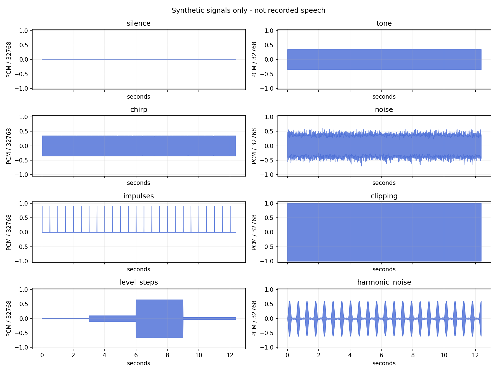
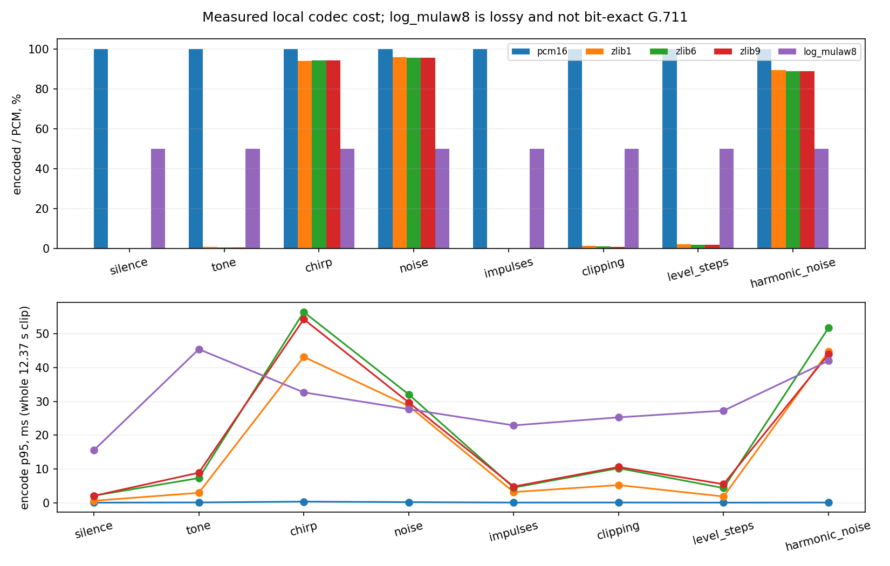
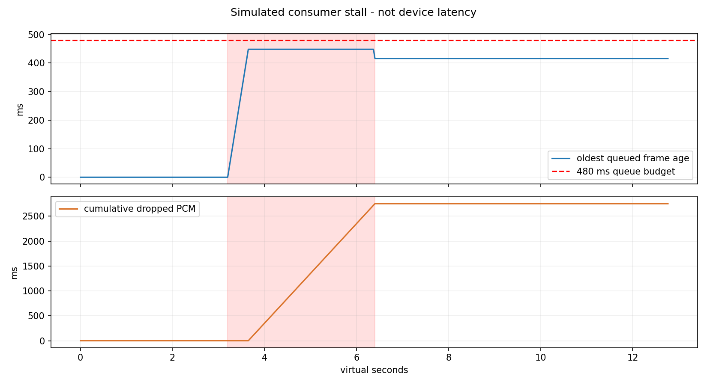

# Рабочий журнал и итог / Work log / 工作日志 — 2026-10-25

**[RU](#ru) · [ENG](#eng) · [CH](#ch)**

## RU

Проверяемая база: Dewiar **0.45.3**, Android **0.7.1**, commit `32fcd918f21fc606efc0ed37870ac8edb9d1a290`.
Журнал описывает наши действия; он не доказывает принятие изменений автором Dewiar.

1. Сохранена линия дополнений: маршрутизация моделей и промптов, отдельные задачи, контроль состояния,
   CLI/API, ограниченный доступ к памяти, языки RU/ENG/CH, аудиоимпорт и локальный буфер.
2. В PC build36 исправлено отбрасывание китайского ответа при выбранном CH. В Android 005 исправлен
   ошибочный русский fallback после выбора ENG/CH; язык записи фиксируется в начале сессии.
3. Исправлены 7 несовпадений after-хешей прежнего Android-пакета из-за CRLF/LF. Код совпадал после
   нормализации, но старую квитанцию не переписывали. Новые хеши получены из реально применённых файлов.
4. Полные частные кандидаты проверены отдельно: 73 PC runtime-файла / 16 Android runtime-файлов;
   полные патчи — 226 / 53 файла; малый PC delta — 9 файлов. Применение и обратное применение PASS.
5. Ранее в этом цикле: PC языковые регрессии — 18; Android fallback — 10; браузерные языки — 22;
   Java language policy — 10; Android router и UI — по 24, четыре voice-набора — PASS.
   Это targeted-проверки, не полный просмотр всех изменений upstream и не испытание нового APK.
6. Для публичной поставки выделены собственные модули. Исправлены два дефекта переносимости тестов:
   проверка WAV ссылалась на отсутствующее ядро, а извлечённый тест буфера не импортировал threading.
   App-wiring оставлен отдельной интеграционной проверкой. Команда Git задаёт LF явно для точных хешей.
7. Финальная проверка поставки: 13 комплектов целостности PASS; 10 автономных наборов поведения PASS;
   10 additive-патчей и откатов PASS. PATCH-024/025/027 — только ТЗ, без отдельного runtime.
   Приватные адреса и очевидные ключи в новых файлах не найдены; стандартные константы QEMU просмотрены.

### Аудио: что измерено

Предыдущий build35: 8 синтетических сигналов × 5 вариантов кодирования × 17 повторов = **680** round trips.
Это синтетическая обработка, а не распознавание речи. [Метрики](evidence/audio-synthetic/metrics.json),
[кодеки](evidence/audio-synthetic/codecs.csv), [очередь](evidence/audio-synthetic/queue.csv).

### Общая картина

| Область | Итог |
|---|---|
| Собственные модули, промпты, пакеты и offline-проверки | PASS в указанном объёме |
| Полная готовность новой интеграции | PARTIAL |
| FIFO / c_good | FIFO остаётся базовым; c_good только controlled offline, общий выигрыш не доказан |
| Физический звук, настоящий ASR, модель, аккаунт, память MCP | NOT_RUN этой поставкой |
| Новый APK 0.7.1, установка PC/Android, физический телефон | NOT_RUN |
| Codex в Android APK / Human Memory MCP / векторная память | NOT_CONNECTED в проверенном Android-конструкторе |
| Автообновление | Публикация source-kit не включает установку и не отключает доверие к подписанным выпускам |

### Следующие шаги

- [x] Сохранить точные патчи, ТЗ, промпты и результаты.
- [x] Выделить проверяемые публичные блоки и инструкции RU/ENG/CH.
- [ ] Собрать Android APK из точной базы и проверить подпись, Keystore и холодный запуск.
- [ ] Проверить RU/ENG/CH на нативном Android и реальном аудио по отдельному поручению.
- [ ] Подключать Codex/Human Memory отдельными адаптерами с явными разрешениями.
- [ ] Перед установкой повторно сверить текущую установленную версию, резервную копию и откат.

## ENG

The exact baseline is Dewiar 0.45.3 / Android 0.7.1. PC build36 fixes filtering of deliberately selected Chinese;
Android 005 preserves selected ENG/CH recognition and captures the locale at recording start. Prior newline-only
manifest mismatches are recorded rather than hidden. Private full-patch checks cover 73/16 runtime hashes and
226/53 complete changed files. Current public delivery passes 13 integrity checks, 10 standalone behavior suites
and 10 additive apply/reverse checks; three blocks are specifications only. The full integration remains PARTIAL.
The audio graphs show 680 synthetic codec round trips, not speech recognition. No new APK, installation, live
audio, model, account or MCP test is claimed. Next: isolated APK build/native language verification, then explicit
adapter integration and an installation with backup/rollback. Publication does not imply upstream acceptance.

## CH

准确基础版本为 Dewiar 0.45.3 / Android 0.7.1。PC build36 修复主动选择中文后回答被过滤的问题；
Android 005 保留 ENG/CH 识别语言，并在录音开始时固定语言。旧换行格式哈希问题被保留记录。
私有完整补丁验证了 73/16 个运行文件和 226/53 个完整修改文件。公开包的 13 份完整性检查、
10 组独立行为测试和 10 组新增文件补丁/回滚通过，三个模块仅为规格。整体集成仍为 PARTIAL。
图表来自 680 次合成信号编解码往返，不代表语音识别。未进行新 APK 构建、安装、真实音频、模型、账户或 MCP 测试。
下一步是独立 APK 构建与原生语言验证，然后按明确权限连接适配器，并准备备份回滚。公开发布不代表上游接受。
